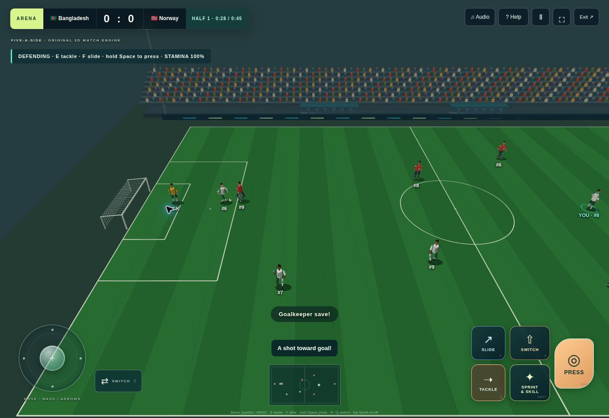

# Football Championship

A free, independent football game with online room-code multiplayer, offline solo matches and a five-chapter Road to Glory adventure. Built with ChatGPT Work and published with ChatGPT Sites.

**[Play the live game](https://football-championship-arena.nuttybeam2.chatgpt.site/game)**



## Features

- Rooms for 2–8 participants across devices. Two teams play each fixture while other participants spectate.
- Original five-a-side action with an analog joystick, contextual attacking/defending controls, tackles, skills and stamina.
- 195-country roster, 24 fictional clubs and 26 competition options using custom eight-entry formats.
- Tactical Battle and Manager modes alongside direct pitch gameplay.
- Road to Glory challenges with locally saved stars and progression.
- English browser-voice commentary, captions, original synthesized instrumental music and independent audio controls.
- Installable web app, cached offline solo play, and an in-app manual.
- Server-authoritative online scores, validated inputs, host permissions and expiring rooms.

## How to play

Open the live game and select **Play a match** for a 90-second solo match. For multiplayer, choose **Play with friends**, create a room, and share the game URL and room code. Use **How to play** or in-match **Help** for full rules.

| Input | Attacking | Defending |
| --- | --- | --- |
| WASD / arrows / joystick | Move and dribble | Move selected defender |
| E | Pass | Standing tackle |
| F | Through ball | Slide tackle |
| Space | Shot | Hold pressure |
| R | Clear | Switch player |
| Q | Select ball carrier | Switch player |
| Shift | Sprint and initial body feint | Sprint |

On-screen Sprint toggles assisted sprint on/off. Sprint uses stamina. The home side attacks right; the away side attacks left. A higher score wins, with simulated penalties for knockout draws. Arcade boundary rebounds are used; official offside, fouls, cards, corners and throw-ins are not implemented.

## Technology

JavaScript, TypeScript, HTML/CSS, native WebGL with software projection fallback, Web Audio, Speech Synthesis, service workers, Vinext/Vite, Cloudflare Workers and D1.

GitHub hosts the source and portfolio documentation. **GitHub Pages cannot run the multiplayer backend.** The live multiplayer application is hosted on ChatGPT Sites. Repository configuration omits the original Site project identifier and contains no player database or local runtime state.

## Verification

```sh
node scripts/game-test.mjs
node scripts/pitch-test.mjs
node scripts/controls-test.mjs
node scripts/audio-test.mjs
```

The tournament checks cover 78 complete tournaments across 26 competitions and three modes. Separate API checks validate two-client play, permissions and state handling. To run the API test against a deployment you own:

```sh
GAME_TEST_ORIGIN=https://your-game-origin node scripts/api-test.mjs
```

The API test creates game rooms. See [development notes](docs/development-notes.md) and project scripts for the Sites/Cloudflare development environment.

## What I learned

I used ChatGPT Work to turn a football concept into a playable web project, then iterated through testing and bug reports. The main challenges were synchronizing multiplayer scores, making movement and defensive controls usable, and keeping the manual consistent with gameplay.

## Next improvements

- Smoother player animations and more responsive mobile controls.
- Better match balancing and clearer player switching.
- Expanded testing across phones, tablets and browsers.

## Artwork and credits

The image above is actual gameplay. [Promotional cover artwork](docs/cover-art.png) is AI-generated illustration and is not a gameplay screenshot. Historical photographs and reference logos have separate credits and terms in [media credits](public/media-credits.html). Playable characters and clubs are original creations. This independent project is not affiliated with FIFA, UEFA, EA or the depicted players. No blanket license is asserted over third-party media.
